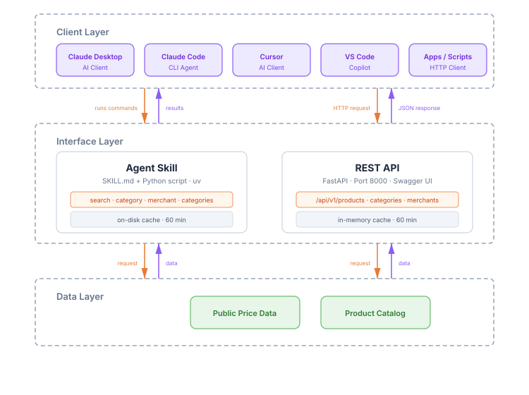

# Greek Supermarket

Compare supermarket prices in Greece, in one place.

Prices for the same product differ from store to store. This project collects them and makes them easy to look up, either by **asking an AI assistant** or by **calling a simple web API**.



## What you can do with it

- Find the cheapest price for a product ("cheapest olive oil")
- Compare one product across stores (ΑΒ, Masoutis, My Market, Bazaar, Kritikos and others)
- Build a shopping list and see where it costs least
- Browse products by category or by store

It covers about 2,800 products. Prices are refreshed every 60 minutes.

## How it's built

The project has two parts that use the same data. You can use either one.

| Part | What it is | Who it's for |
|------|------------|--------------|
| **Agent Skill** (`skills/greek-supermarket/`) | A plug-in for AI assistants such as Claude Code. You ask in plain English or Greek, and it looks up prices and replies with a sorted table. | Anyone who wants answers, not code |
| **REST API** (`api/`) | A small FastAPI server that returns product and price data as JSON. | Developers building their own app |

There is also a documentation site in `docs/` (built with Docusaurus).

## Quick start

You need [uv](https://docs.astral.sh/uv/) installed.

```bash
git clone https://github.com/kostantinostheo/greek-supermarket.git
cd greek-supermarket
```

### Option 1: Use the Agent Skill

Link the skill into your assistant's skills folder (Claude Code shown):

```bash
ln -s "$(pwd)/skills/greek-supermarket" ~/.claude/skills/greek-supermarket
```

Then ask your assistant things like:

```
Find me the cheapest olive oil
Σύγκρινε τιμές για γάλα σε όλα τα σούπερ μάρκετ
Build me a shopping list: chicken, rice, tomatoes, dish soap
What does Sklavenitis sell?
```

If your request is vague (for example "chicken"), the assistant asks which kind you mean before searching. It answers in the language you wrote in.

You can also run the lookup script yourself:

```bash
cd skills/greek-supermarket
uv run scripts/supermarket.py search "γαλα δελτα"
```

### Option 2: Run the REST API

```bash
cd api
uv sync
uv run server.py
```

The API runs at `http://localhost:8000`. Interactive docs are at `http://localhost:8000/api-docs`.

## API endpoints

All endpoints are under `/api/v1`.

| Endpoint | Returns |
|----------|---------|
| `GET /products` | Paginated list of products (`page`, `limit`, `orderBy`, `order`) |
| `GET /products/search?q=...` | Products matching a name (ignores case and accents) |
| `GET /products/length` | Total number of products |
| `GET /products/category/{name}` | Products in a category |
| `GET /products/merchant/{name}` | Products sold by a store, with that store's price |
| `GET /categories` | All category names |
| `GET /merchants` | All store names |

Example:

```bash
curl "http://localhost:8000/api/v1/products/search?q=γαλα"
```

Each product has a name, barcode, category, image and a list of prices, one per store.

The API allows 100 requests per 15 minutes per client.

## Project layout

```
api/       FastAPI server (routes, data transformer, helpers)
skills/    The Agent Skill (SKILL.md + lookup script)
docs/      Documentation website
```

## Data source

Product and price data comes from publicly available sources. Both the API and the skill cache it for 60 minutes, so prices can be up to an hour old.

## More documentation

Full docs: https://kostantinostheo.github.io/greek-supermarket/
